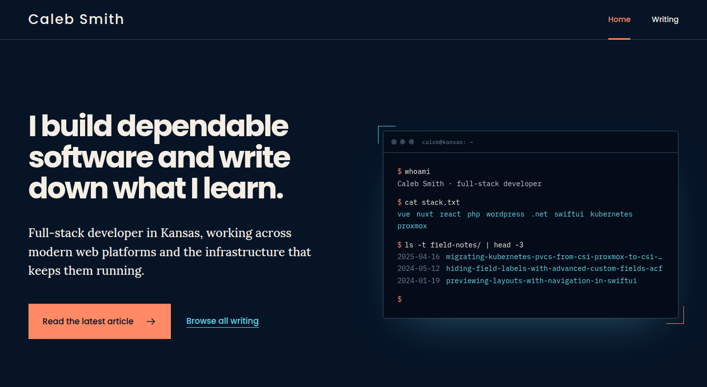

<div align="center">

# caleb-smith.dev

The personal site and Markdown-powered blog of Caleb Smith.

[](https://github.com/calebsmithdev/personal-site-nuxt/actions/workflows/ci.yml)


**[Visit the site →](https://caleb-smith.dev)**

<br>



</div>

---

## Contents

- [Overview](#overview)
- [Quick start](#quick-start)
- [Commands](#commands)
- [Project structure](#project-structure)
- [Writing an article](#writing-an-article)
- [Images and fonts](#images-and-fonts)
- [SEO and analytics](#seo-and-analytics)
- [Testing and CI](#testing-and-ci)
- [Build and deployment](#build-and-deployment)

## Overview

The site has three routes:

| Route | Page |
| --- | --- |
| `/` | Homepage with an animated terminal hero and the latest articles |
| `/blog` | Index of every article |
| `/blog/<slug>` | An article, with a table of contents and syntax-highlighted code blocks that can be copied |

### Stack

| Area | Tools |
| --- | --- |
| Framework | [Nuxt 4](https://nuxt.com/docs/4.x/getting-started/installation), Vue 3, TypeScript |
| Content | [Nuxt Content 3](https://content.nuxt.com/docs/getting-started/installation), a typed `blog` collection backed by SQLite (`better-sqlite3`) |
| SEO | `@nuxtjs/sitemap`, `@nuxtjs/robots`, route-level metadata in `useSiteSeo` |
| Styling | Hand-written CSS, self-hosted Fontsource fonts, Font Awesome icons |
| Analytics | Google Analytics through `vue-gtag`, enabled only when configured |
| Quality | ESLint, `vue-tsc`, Vitest with `@nuxt/test-utils` |
| Hosting | [Laravel Cloud](https://cloud.laravel.com) |

## Quick start

> [!NOTE]
> You need **Node.js 26** (pinned in `.nvmrc`) and **npm**. If you use nvm, run `nvm use` from the repository root first.

```bash
npm ci        # install the exact dependencies in package-lock.json
npm run dev   # start the dev server at http://localhost:3000
```

`package-lock.json` is the authoritative lockfile. After installing, npm runs `postinstall` (`nuxi prepare`) to generate Nuxt's types.

Analytics is optional. To try it locally, copy the example file and fill in the ID:

```bash
cp .env.example .env
```

## Commands

| Command | What it does |
| --- | --- |
| `npm run dev` | Starts the Nuxt development server. |
| `npm run check` | Runs lint, typecheck, tests, and the production build in that order. **CI runs this same command.** |
| `npm run lint` | Lints the repository with ESLint. |
| `npm run typecheck` | Runs Nuxt's TypeScript checks. |
| `npm run test` | Runs the Vitest `unit`, `nuxt`, and `e2e` projects. |
| `npm run generate` | Prerenders the static site into `.output/public/`. |
| `npm run build` | Builds the Node/Nitro server into `.output/`. |
| `npm run preview` | Previews the latest build locally. |
| `npm run start` | Runs the built server from `.output/server/index.mjs`. Run `npm run build` first. |

## Project structure

```text
.
├── app/
│   ├── assets/          # CSS, the profile image, and article images
│   ├── components/      # Header, footer, hero terminal, and article components
│   │   └── content/     # ProseImg and ProsePre overrides for Markdown rendering
│   ├── composables/     # useBlog, useSiteSeo, useAsset
│   ├── layouts/         # Default layout
│   ├── pages/           # /, /blog, /blog/[...slug]
│   ├── plugins/         # Optional Google Analytics plugin
│   └── utils/           # Article helpers such as date formatting
├── content/blog/        # Article Markdown files
├── public/              # Favicons and other files served as-is
├── test/
│   ├── unit/            # Node unit tests
│   ├── nuxt/            # Component and composable tests in the Nuxt environment
│   └── e2e/             # Tests that render real routes
├── content.config.ts    # Typed blog collection and frontmatter schema
└── nuxt.config.ts       # Modules, fonts, Markdown highlighting, site URL
```

## Writing an article

Add a Markdown file to `content/blog/`. The file path sets the URL:

```text
content/blog/example-article.md   →   /blog/example-article
content/blog/nuxt/routing.md      →   /blog/nuxt/routing
```

Every article starts with frontmatter. `content.config.ts` validates it:

```yaml
---
title: 'Article title'              # required, non-empty
description: 'One-sentence summary.' # required, non-empty
date: 2026-07-29                     # required, YYYY-MM-DD
categories: ['Nuxt']                 # required, at least one entry
tags: ['vue', 'routing']             # optional, array of strings
image: '/assets/img/blog/cover.png'  # optional, string
sitemap:
  lastmod: 2026-07-29                # required, YYYY-MM-DD
---

Write the article body in Markdown here.
```

> [!TIP]
> When you edit a published article, update `sitemap.lastmod` so the sitemap reports the change.

Code blocks are highlighted with the `material-theme-palenight` theme. The supported languages are listed in `nuxt.config.ts`. Headings down to level 3 appear in the table of contents.

## Images and fonts

**Images.** Put article images in `app/assets/img/blog/` and reference them in Markdown as `/assets/img/blog/<filename>`. The `ProseImg` component resolves that path through the asset pipeline and adds `loading="lazy"` and `decoding="async"`.

**Fonts.** Fontsource provides self-hosted fonts, loaded before `app/assets/css/typography.css`:

| Font | Weights | Used for |
| --- | --- | --- |
| Lora | 500 | Body text |
| Poppins | 500, 700 | Headings |
| IBM Plex Mono | 400, 500 | Labels, metadata, and code |

## SEO and analytics

The homepage, blog index, and article pages each set their own title, description, canonical URL, Open Graph tags, and Twitter tags.

- Canonical URLs, the sitemap, and `robots.txt` all use the site origin `https://caleb-smith.dev` from `nuxt.config.ts`.
- The homepage and blog index have the Open Graph type `website`. Articles have the type `article`.

Google Analytics is **optional**. Set the public runtime key in `.env` to turn it on:

```dotenv
NUXT_PUBLIC_GOOGLE_ANALYTICS_ID=
```

If the value is empty, the analytics plugin doesn't start and no tracking code loads.

## Testing and CI

Before you open a pull request, run the same check that CI runs:

```bash
npm run check
```

Vitest has three projects:

| Project | Files | Environment |
| --- | --- | --- |
| `unit` | `test/unit/**/*.spec.ts` | Node |
| `nuxt` | `test/nuxt/**/*.nuxt.spec.ts` | Nuxt, through `@nuxt/test-utils` |
| `e2e` | `test/e2e/**/*.spec.ts` | Node, files run one at a time |

The [CI workflow](.github/workflows/ci.yml) runs on pull requests and on pushes to `main`. It reads the Node version from `.nvmrc`, caches npm, runs `npm ci`, and then runs `npm run check`. It has read-only access to repository contents, and a new run cancels any older run on the same ref.

Git ignores generated output in `.nuxt/`, `.output/`, `.data/`, and `.nuxtrc`. Don't edit those files by hand.

## Build and deployment

Production runs on **[Laravel Cloud](https://cloud.laravel.com)** at `caleb-smith.dev`. The build and deploy settings live in the Laravel Cloud dashboard, not in this repository.

Nuxt can produce two kinds of output:

| Output | Commands | Result |
| --- | --- | --- |
| Node/Nitro server | `npm run build`, then `npm run start` | A server in `.output/server/index.mjs` |
| Static site | `npm run generate` | Prerendered files in `.output/public/` |

Use `npm run preview` after a build to try the production output locally. The [Nuxt deployment docs](https://nuxt.com/docs/4.x/getting-started/deployment) list every output format Nuxt supports.

> [!IMPORTANT]
> This repository contains no hosting credentials. Keep tokens and account IDs in the hosting provider's secret settings, never in tracked files.
